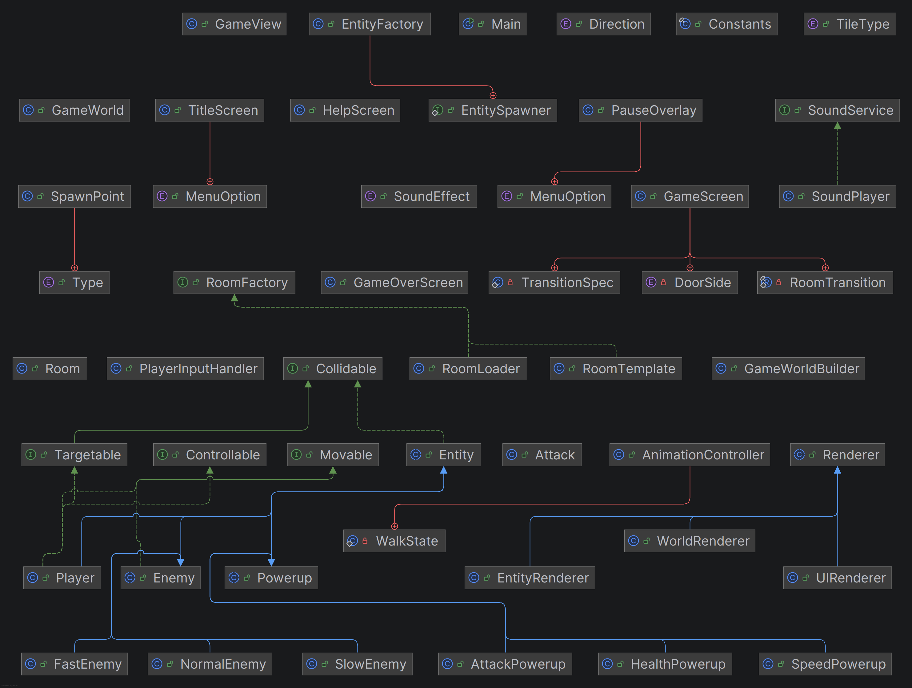

# Yet Another Dungeon-Crawler

## Team - Sprite Zero
Fredrik Udengen, Njål Nordal, Guangwei Zhang, Kim Huynh, Leila Lu

## Konsept
Spillet er et dungeon-crawler spill hvor spilleren kjemper gjennom ulike rom med fiender og powerups. Når alle fiender 
er drept i et rom, kan spilleren bevege seg til neste rom. Målet er å rydde så mange rom som mulig, uten å dø. 

## Brukerveiledning
- WASD beveger spilleren.
- Piltastene bestemmer hvilken retning spilleren slår.

## Teknologier
- Java 25 eller nyere
- LibGDX
- Maven

## Kilde / Opphavsrett
Se resources/sourceList.txt

## Hvordan kjøre spillet
- mvn package
- java -jar target/dungeoncrawler-1.26-SNAPSHOT-fat.jar

## Klassediagram

